# Multi-Cam usage guide

Multi-Cam lets one **Controller** (a web dashboard) watch and record from several **Remote** phones. Each phone records its own full-quality video and uploads it to the server when you stop. A live preview runs at low quality alongside, only so the Controller can see what the phone sees.

The app and dashboard are in Vietnamese. English meanings are given in brackets below. The screenshots were taken on an Android emulator, so the camera picture is a flat green frame; a real phone shows the real camera.

| Who | Uses | Does |
|---|---|---|
| Controller | Web dashboard in a browser | Creates a room, shares the invite code, starts/stops recording, watches the preview, plays and downloads videos |
| Remote | Android app on a phone | Joins the room, broadcasts the preview, records and uploads |

You need an account for each person. Ask whoever runs the server for one. (Test deployments seed demo accounts; see `src/db/seed.ts`. Change them before real use.)

## 1. Install the app (Remote phones)

1. On the phone, open the release page and download `horus-recorder-m4-arm64.apk`: <https://github.com/blackcat2005/horus-app/releases/tag/v0.1.0-recorder-m4>
2. Open the file and allow "install unknown apps" for your browser or file manager when Android asks.
3. Open **Multi-Cam Recorder** and allow Camera and Microphone.

Needs a 64-bit ARM Android phone (almost all phones since 2017). The build is signed with the public Android debug key, so it is for testing only.

## 2. First run: connect to the server

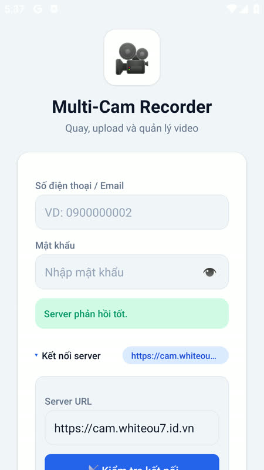

1. Under **Kết nối server** (Server connection), type the **Server URL**, for example `https://cam.whiteou7.id.vn`. Use `https://` and no port.
2. Tap **Kiểm tra kết nối** (Test connection). A green **Server phản hồi tốt** ("Server responds well") means the phone can reach the server.
3. Enter the **Số điện thoại / Email** (phone or email) and **Mật khẩu** (password) of a Remote account and sign in.

You can change the URL later in the **Cài đặt** (Settings) tab.

## 3. Controller: open the dashboard and create a room

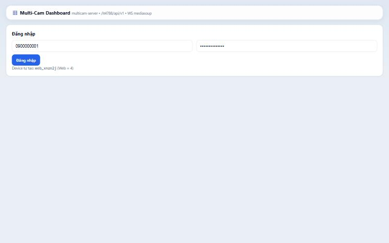

1. Open the server address in a browser, for example `https://cam.whiteou7.id.vn/`, and click **Đăng nhập** (Sign in) with a Controller account.
2. In **Quản lý phòng** (Room management) click **+ Tạo phòng (Controller)** to create a room. Use **↻ Mã mới** to make a new invite code at any time.
3. The code appears next to **Mã mời** (Invite code). Send it to the people holding the phones.

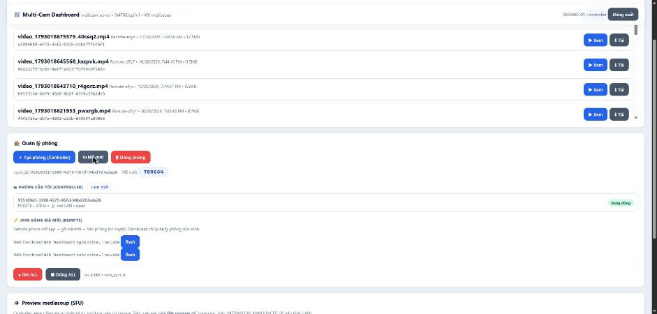

## 4. Remote: join the room and broadcast

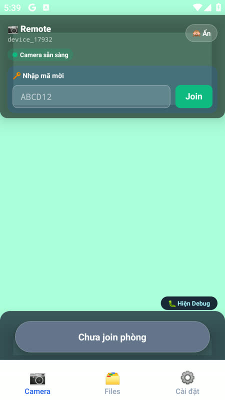

1. In the **Camera** tab, type the code under **Nhập mã mời** (Enter invite code) and tap **Join**. A box says **Đã join** (Joined); tap OK. If the room needs approval, the phone shows **Chờ Controller duyệt** (Waiting for the Controller to approve) until the Controller accepts.

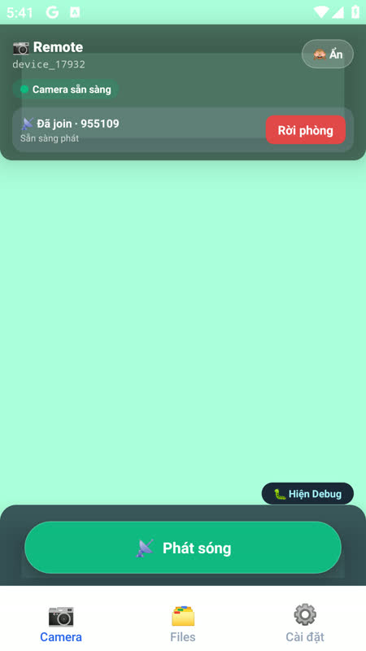

2. The phone now says **Đã join · …** and **Sẵn sàng phát** (Ready to broadcast).
3. Tap the green **📡 Phát sóng** (Broadcast) button. The Controller cannot start the phone's camera by itself: until someone taps this, the dashboard has nothing to show.

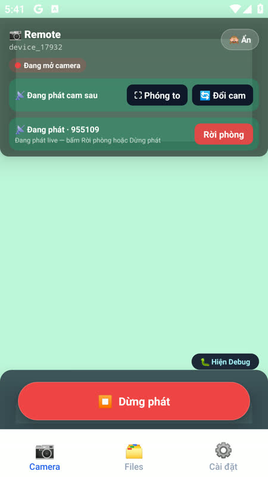

While broadcasting, the phone shows **Đang phát cam sau** (Broadcasting the rear camera). **Đổi cam** (Switch camera) swaps front and rear, **Phóng to** (Enlarge) fills the screen, and **Dừng phát** (Stop broadcasting) ends the preview. The app keeps the screen awake while broadcasting; leave it that way, since a sleeping phone can stall the camera.

## 5. Controller: watch the live preview

1. On the dashboard, scroll to **Preview mediasoup (SFU)** and click **▶ Bật preview (recv)** (Turn on preview).
2. When the phone is broadcasting, the line **Đang xem 1 luồng video** (Watching 1 video stream) appears and the phone's picture shows below it, labelled with the phone's name. Without a broadcasting phone it waits with "Đang chờ Remote phát sóng…".
3. **■ Tắt preview** turns it off.

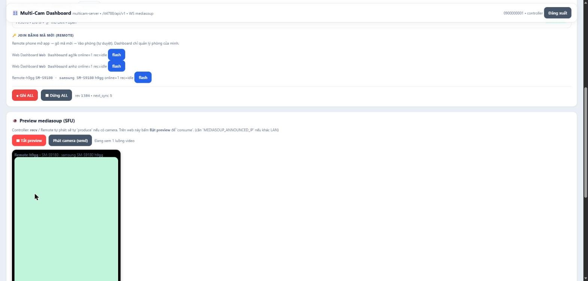

The preview is deliberately low quality. It is not what gets saved.

## 6. Record

1. On the dashboard, click **● Ghi ALL** (Record all) to start recording on every phone in the room.
2. Each phone shows **Đang quay (1080p) — preview vẫn đang phát** (Recording 1080p, preview still running).
3. Click **■ Dừng ALL** (Stop all) to stop. The dashboard shows a message box saying the stop command was sent. **Click OK on it**: the page cannot be used until you do.

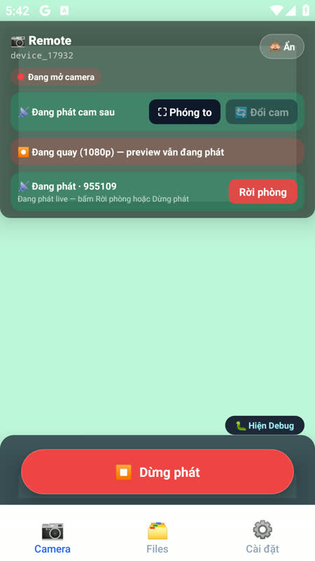

Each phone finishes its file and uploads it automatically as soon as it gets the stop command. Keep the phone connected and the app open until the upload ends. When it is done, the phone's **Files** tab is empty again, because the local copy is removed after a successful upload.

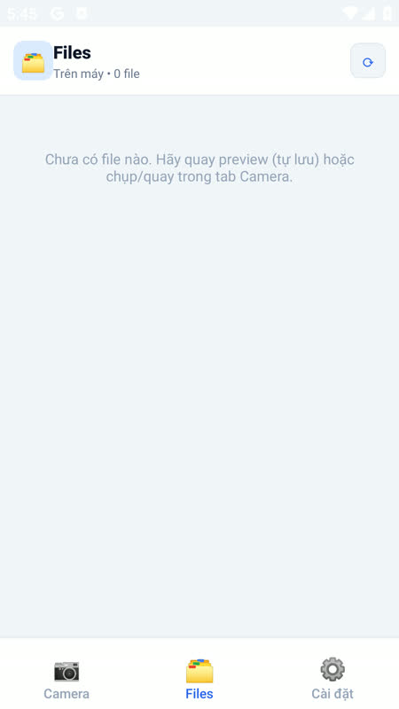

Tips:
- Clips over about 100 MB can fail to upload if the server sits behind the free Cloudflare plan (it limits one upload to 100 MB). At 1080p a minute of video is roughly 45 MB, so keep takes to a couple of minutes or ask the admin to bypass the proxy for the storage address.

## 7. Watch and download videos

1. In **Video trên server** (Videos on server) click **Tải lại** (Reload) to refresh the list. Each row shows the file name, the phone that recorded it, the time and the size.
2. **▶ Xem** (Watch) plays it in the page. **⬇ Tải** (Download) saves the file.

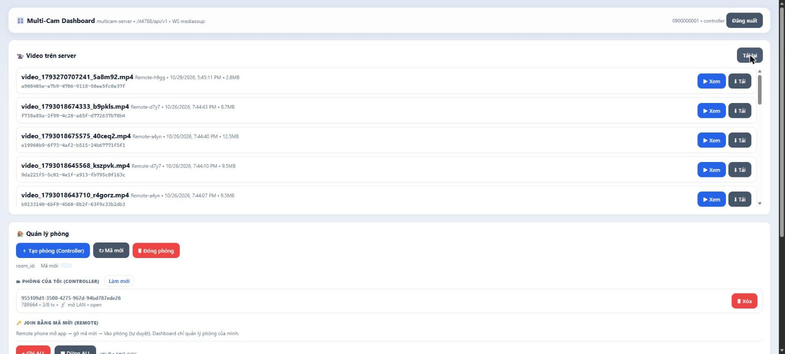

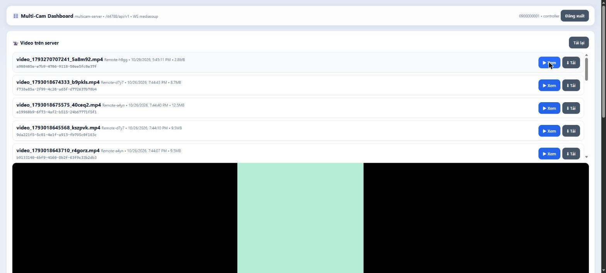

Videos are H.264 video with AAC audio in an MP4 file.

## 8. The Settings tab

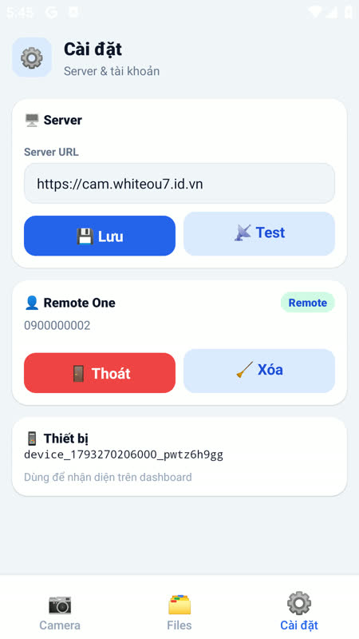

- **Server URL**: change it, tap **Lưu** (Save) and **Test** to check.
- **Thoát** (Sign out) logs the phone out. **Xóa** (Force sign-out) clears the saved session and returns to the login screen; use it only if **Thoát** does not respond.
- **Thiết bị** (Device) shows the id this phone uses on the dashboard.

## 9. Troubleshooting

| Problem | Cause and fix |
|---|---|
| Test connection fails | Check the URL starts with `https://`, has no port, and the phone has internet. |
| Dashboard shows "Đang chờ Remote phát sóng…" | The phone has not tapped **Phát sóng**, or has not joined the room. |
| Preview stays black or never connects | The server's media ports must be open: UDP and TCP `40100-40199`, and `MEDIASOUP_ANNOUNCED_IP` must be the server's public IP. Some networks block UDP. |
| Dashboard hangs after Record or Stop | A message box is waiting. Click OK. |
| Video missing from the list | Click **Tải lại** and wait for the phone to finish uploading. |
| Video in the list will not play | Make sure it came from a phone recording; test files can be invalid. |

Known issues in this test build: on the sample recording the picture started about one second after the sound, and one frame had a repeated timestamp. The phone's recorder had only been tried briefly on a real phone, and on an emulator it recorded at a low frame rate, so check your own recordings.

## For admins

Deployment (Docker, Caddy, ports) is in [README.md](README.md). The API is in [API.md](API.md).
